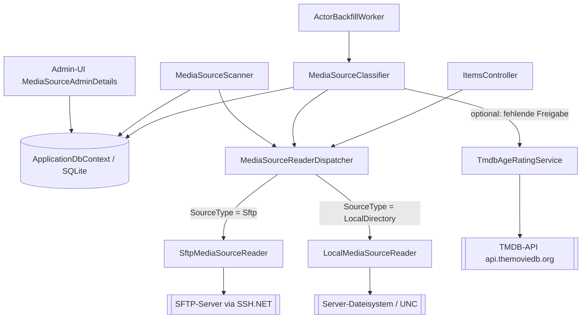

← [Zurück zur Übersicht](index.md)

# Medienquellen — Architektur

## Beteiligte Komponenten

| Komponente | Typ | Rolle |
|------------|-----|-------|
| `MediaSourceAdminDetails.razor` / `MediaSourceAdmin.razor` | Blazor-Komponenten | Admin-UI: Typauswahl, typabhängige Felder, Pfadvalidierung, Typ-Spalte in der Übersicht |
| `MediaSource` / `MediaSourceType` | Datenmodell | `SourceType`-Diskriminator (`Sftp` = 0, `LocalDirectory` = 1) |
| `IMediaSourceReader` | Interface | Einheitlicher Dateizugriff: Verzeichnis-Enumeration, Datei-Existenz/-Inhalt, Streaming |
| `SftpMediaSourceReader` | Service (scoped) | Implementierung für entfernte SFTP-Quellen (SSH.NET `SftpClient`) |
| `LocalMediaSourceReader` | Service (scoped) | Implementierung für lokale Verzeichnisse per `System.IO` inkl. Root-Präfixprüfung |
| `MediaSourceReaderDispatcher` | Service (scoped, als `IMediaSourceReader` registriert) | Wählt pro Aufruf anhand von `SourceType` den konkreten Reader |
| `MediaEntryFilter` | Interne Hilfsklasse | Gemeinsame `.`-Ignorierregel beider Reader |
| `MediaSourceScanner` / `MediaSourceClassifier` | Services | Scan und Klassifizierung über `IMediaSourceReader` |
| `AgeRatingNormalizer` / `AgeRatingResult` | Statische Hilfsklasse / Record (`VideoWebPlayer/Utils`) | Normalisiert Altersfreigabe-Rohwerte aus NFO/TMDB auf kanonische FSK-/MPAA-Stufen plus `MinAge`; `CanonicalOptions` ist die einzige Quelle der UI-Auswahlwerte |
| `ITmdbAgeRatingService` / `TmdbAgeRatingService` | Interface / Service (Singleton) | Optionaler Online-Fallback für fehlende Freigaben (TMDB `release_dates`/`content_ratings`) über named `HttpClient` „Tmdb"; liefert `null` statt Fehler |
| `TmdbOptions` | Optionsklasse | Konfigurationsabschnitt `Tmdb` (`Enabled`, `ApiKey`, `BaseUrl`, `PreferredCountry`, `TimeoutSeconds`) |
| `AgeRatingSelect.razor` | Blazor-Komponente | Freigabe-Auswahl im Admin-Editiermodus; nicht-kanonische Bestandswerte bleiben als „übernommen"-Option wählbar |
| `ActorBackfillWorker` | BackgroundService | Startet neben der Schauspieler-Nacherfassung auch `BackfillMissingAgeRatingsAsync` für den Altbestand |
| `ItemsController` | API-Controller | Streaming/Download über `OpenFileStream`; `UpdateMetadata` nimmt `AgeRating` für `movie`/`tvshow` entgegen |
| `VideoWebPlayerBackupData` | Backup-Service | Serialisiert `SourceType` automatisch; Restore-Toleranz via `OptionalRestoreColumns`/`OptionalRestoreIntDefaults` (inkl. der acht `AgeRating*`-Spalten) |

## Abhängigkeiten

- `SftpMediaSourceReader` → externer SFTP-Server via SSH.NET (`Renci.SshNet`), synchron aus Sicht der Anwendung.
- `LocalMediaSourceReader` → Server-Dateisystem (`System.IO`), inkl. UNC-Pfaden/Netzwerkfreigaben; keine neue externe Abhängigkeit.
- `TmdbAgeRatingService` → externe TMDB-REST-API (`api.themoviedb.org`), synchron, pro Eintrag maximal ein Lookup; strikt optional — ohne `Tmdb:Enabled`/`ApiKey` inert, Fehler werden zu `null` statt zum Scan-Abbruch. IMDb ist nicht angebunden (keine freie offizielle API).
- DI-Registrierung in `Extensions/ServiceCollectionExtensions` (Zeile ~232): `SftpMediaSourceReader` und `LocalMediaSourceReader` scoped; `IMediaSourceReader` → `MediaSourceReaderDispatcher` (scoped). Daneben (Zeile ~241): `Configure<TmdbOptions>` (Abschnitt „Tmdb"), `AddHttpClient(TmdbAgeRatingService.HttpClientName)`, `AddSingleton<ITmdbAgeRatingService, TmdbAgeRatingService>`; der Classifier erhält den Service als optionalen Ctor-Parameter.

## Datenfluss

1. Admin legt Quelle mit `SourceType` an → `ApplicationDbContext` persistiert in Tabelle `MediaSources` (Spalte `SourceType`, `int`).
2. `MediaSourceScanner` fragt `IMediaSourceReader.ReadRootDirectory`/`ReadDirectoryEntries` → Dispatcher wählt Reader → Ergebnisse landen als `MediaCollections`/`MediaItems` in der Datenbank.
3. `MediaSourceClassifier` liest NFO-/Bilddateien über `IMediaSourceReader` → Metadaten in Datenbank. Dabei normalisiert `AgeRatingNormalizer` die NFO-Freigabe (`<mpaa>`/`<certification>`); bei fehlender NFO-Angabe ergänzt `TmdbAgeRatingService` den Wert online → `AgeRating`/`AgeRatingRaw`/`AgeRatingMinAge` auf `Movies`/`TVShows`.
4. `ActorBackfillWorker` ruft beim Start `BackfillMissingAgeRatingsAsync` → versorgt Altbestand (`AgeRatingClassifiedAt`-Marker verhindert Wiederholung).
5. `ItemsController.StreamMediaItem`/`Download` öffnet den Videostream über `IMediaSourceReader.OpenFileStream` → HTTP-Response mit Range-Verarbeitung. `UpdateMetadata` schreibt Admin-Änderungen (inkl. `AgeRating` für `movie`/`tvshow`) über `MediaMetadataEditorService`.

## Diagramm

## Skalierung und Zuverlässigkeit

- Nicht erreichbare lokale Quellen (z. B. nicht gemountetes Laufwerk oder nicht auflösbare Freigabe) führen nicht zum Abbruch des Scans: Der Scanner fängt die Dateisystem-Exceptions pro Collection ab und terminiert den nächsten Versuch über `ScanDueAt` neu.
- Bei nicht geladener `MediaSource`-Navigation (`collection.MediaSource is null`) wirft der Dispatcher eine `InvalidOperationException` mit Hinweis auf das erforderliche Eager-Loading (`Include(mc => mc.MediaSource)`).
- Tests können einen Fake direkt als `IMediaSourceReader` registrieren und den Dispatcher umgehen.
