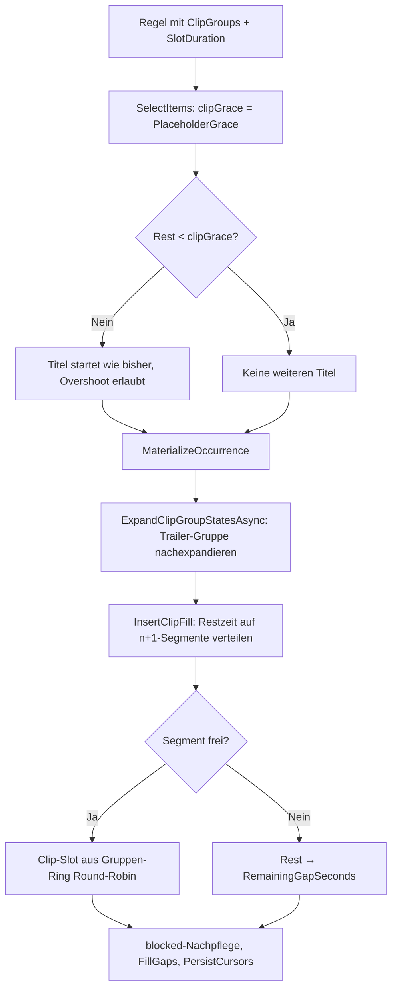

# TV-Sender — Technischer Ablauf

Technische Abläufe des automatischen TV-Senders in zwei Teilen: „Clip-Gruppen und
Restzeit-Auffüllung" beschreibt die Sendeplan-Generierung mit Platzhalter-Clips,
„Standby-Stream des Live-Streams" die Auslieferung der Warm-up-Phase und aller Zustände
ohne produzierte Segmente.

## Clip-Gruppen und Restzeit-Auffüllung

### Übersicht

Clip-Gruppen hängen benannte Mengen unklassifizierter Video-`MediaItem`s an `ProgramRule`s.
Steuert eine Regel mindestens eine Gruppe und besitzt eine `SlotDuration`, ersetzt die je-Regel-
Karenzzeit `ProgramRule.PlaceholderGrace` die Titel-Startschwelle am Periodenende: Unterschreitet
die Restzeit die Karenzzeit, startet kein Titel mehr; stattdessen verteilt ein eigener Nachpass
(`ProgramScheduleService.InsertClipFill`) Clip-Slots gleichmäßig auf die `n+1`-Segmente der
Ausstrahlung. Die reservierte System-Gruppe „Trailer" (`ProgramClipGroup.TrailerGroupId = 1`)
wird verzögert aus den frisch materialisierten Film-Ausstrahlungen des Laufs expandiert.

Die bisherige Lückenfüllung `FillGaps` (Platzhalter/Füller-Regeln **zwischen** Ausstrahlungen)
läuft unverändert danach; die Clip-Füllung liegt **innerhalb** der Periode einer Ausstrahlung.

### Ablauf

#### 1. Gruppen- und Mitgliederverwaltung

`TVSenderAdminClipGroups.razor` (Tab „Clip-Gruppen" auf `TVSenderAdmin.razor`) ruft
`IProgramClipGroupService` — jede Methode erzwingt serverseitig `RequireAdminAsync`; alle
Mutationen feuern `IProgramScheduleSignal.NotifyScheduleChanged()`.

Beteiligte Komponenten:

- `ProgramClipGroupService.GetGroupsAsync` / `GetGroupCountsAsync` — Gruppenliste (Name ASC)
  samt Mitgliederzahlen; liefert auch die System-Gruppe „Trailer", sofern die Seed-Zeile existiert.
- `CreateGroupAsync` / `RenameGroupAsync` / `DeleteGroupAsync` — `ValidateGroupNameAsync`
  (nicht leer, ≤ `ProgramClipGroup.NameMaxLength` = 255, ordinal-ignore-case eindeutig, ≠
  `TrailerGroupName` für freie Gruppen); `IsSystem`-Gruppen sind für Umbenennen/Löschen gesperrt
  (`InvalidOperationException`). Der NOCASE-Unique-Index auf `Name` sichert die Dubletten- und
  Reservierungsregel zusätzlich auf DB-Ebene ab.
- `GetGroupClipsAsync` — Mitglieder inkl. `Duration`, `DurationProbedAt`, `DurationProbeAttempts`
  und Quellname (Kennzeichnung „keine Laufzeit" in der UI).
- `GetClipCandidatesAsync` — Kandidatenliste: `MediaItem`s **ohne** `MovieMediaItem`-/
  `TVShowEpisodeMediaItem`-Link aller Quellen, LIKE-Suche über `Name` (Wildcard-Escaping),
  optionaler Quell-Filter, `VideoFileExtensions.IsVideoFileName`-Filter, seitenweise
  (Seitengröße 100 in der UI, `take` serverseitig auf ≤ 200 geklemmt).
- `AddClipsToGroupAsync` — `IsSystem`-Gruppe abgewiesen; jedes `MediaItem` muss existieren,
  Video und unklassifiziert sein (sonst `KeyNotFoundException`/`ArgumentException`);
  Composite-PK `ProgramClipGroupItem` verhindert Dubletten, bereits vorhandene Links werden
  übersprungen. `Duration == null` ist zulässig (wird bei der Expansion ausgefiltert).
- `RemoveClipFromGroupAsync` — entfernt einzelne Mitglieder; `IsSystem` abgewiesen.

#### 2. Regel mit Clip-Gruppen und Karenzzeit speichern

Der Regel-Dialog in `TVSenderAdmin.razor` zeigt bei `RuleType != Filler` die Checkbox-Liste
`#rule-clip-groups` (alle Gruppen inkl. „Trailer" mit Zusatz „(automatisch befüllt)") und — nur
bei gesetzter `DurationMinutes` und mindestens einer gewählten Gruppe — das Feld
`#rule-grace-minutes` mit Wirkungs-Hinweis `#rule-grace-minutes-hint`; sonst den Hinweis
`#rule-clip-groups-hint`. `RuleEditModel.SelectedClipGroupIds`/`GraceMinutes` gehen als
`ProgramRuleInput.ClipGroupIds`/`PlaceholderGrace` in `ProgramRuleService`.

Beteiligte Komponenten:

- `ProgramRuleService.ValidateClipGroupInputAsync` — `ClipGroupIds` nur bei
  `RuleType != Filler` und `SlotDuration != null`; alle Ids müssen existieren
  (`KeyNotFoundException`, die Trailer-Gruppen-Id ist eine reguläre Zeile — fehlt der
  Seed-Datensatz in einer Alt-DB, wird sie wie jede unbekannte Id abgewiesen);
  `PlaceholderGrace` nur mit `SlotDuration`, `> 0` und `< SlotDuration`.
- `CreateRuleAsync` / `UpdateRuleAsync` — setzen `PlaceholderGrace =
  input.PlaceholderGrace ?? ProgramRule.DefaultPlaceholderGrace` (15 min) und ersetzen die
  Links über `ReplaceClipGroupLinksAsync` (Muster `ReplaceGenreLinksAsync`, aber
  materialart-unabhängig).
- `GetRulesAsync` — `Include(r => r.ClipGroups).ThenInclude(c => c.ClipGroup)`;
  `TVSenderAdmin.MaterialLabel` hängt den Suffix „— Clips: {Namen}" an.

#### 3. Plangenerierung (`EnsureCoverageAsync`)

Der Zuschauer-Freigabekontext (`AccessContext` über `LoadAccessContextAsync`, ausgewertet
durch `access.Allows` an den Expansionsstellen) liest zu Beginn die Admin-Einstellung
`Setups.ProgramScheduleContentScope` (`ProgramScheduleContentScope`-Enum, persistiert als
`INTEGER`): Bei `AllContent` liefert sie sofort den `Everything`-Kontext — die
Zuschauer-Freigabeprüfung ist für alle Expansionspfade aufgehoben (`SkippedNoAccess` bleibt
0); bei `SharedOnly` (Default) läuft der bisherige Schnitt über alle Nicht-Admin-Benutzer
unverändert. `ReconcileAsync` und `GetRuleDiagnosesAsync` nutzen denselben Kontext —
beim Zurückschalten verdrängt der Mitgliedschafts-Check nicht mehr reproduzierbare Slots.

1. Regeln werden inkl. `ClipGroups`-Navigation geladen. `BuildClipGroupStates` baut je
   zugeordneter Gruppe (aufsteigend nach `ProgramClipGroupId` = Round-Robin-Reihenfolge) einen
   `ClipGroupState`: Benutzergruppen expandieren sofort über `ExpandClipGroupItemsAsync`
   (Mitglieder, die noch unklassifizierte Videos sind, `Duration != null`,
   `access.Allows(sourceId)` — Filter-Pipeline `FilterClipCandidatesAsync`, geteilt mit
   `ExpandMediaSourceClipsAsync`; `CountNoDuration`/`SkippedNoAccess`-Buchhaltung), die
   Trailer-Gruppe bleibt zunächst leer. `SelectStrandCursor` initialisiert den Ring-Startindex
   je Gruppe über den Cursor-Strang `clipgroup:{groupId}`.
   **Deterministische Ringmischung (Issue #297):** Beim Ringaufbau in `RuleState.SetItems`
   und `ClipGroupState.SetItems` ersetzt `MixUnorderedRing` die Expansionsreihenfolge
   ungeordneter Ringe durch eine Hash-Ordnung — `ItemOrderKey` (FNV-1a über
   `{ruleId}:{strandKey}:{contentType}:{contentId}`, geteilter Kern mit `StrandOrderKey`)
   plus `ContentId`-Tiebreak. Betroffen sind alle Ringe, deren sämtliche Elemente
   `ContentType` `Movie` oder `MediaItem` tragen: Film-Sammlungen, der `other`-Strang
   mehrsträngiger Genre-Expansionen (Seed `"other"`; der einsträngige Flachpfad seedet
   `null`), Clip-Quellen und Nutzer-Clip-Gruppen. Ohne die Mischung startete jede Regel am
   selben Sortier-Ersten (Alphabet/Id/Releasedatum) und bevorzugte ihn systematisch, weil
   Cursor-Anker (`NextIndexFor`) ohne Treffer auf Index 0 zurückfallen. Geordnet bleiben
   `TVShowEpisode`-/`PlaylistEntry`-Stränge (`PreservesOrder`), die airings-geordneten
   Trailer-Ringe und der Genre-Füller-Flachring mit gemischtem Inhalt (dort würde eine
   Vollmischung die Episoden-Sendedreihenfolge zerstören). Die Ordnung ist eine reine
   Funktion der Expansion — Reproduzierbarkeitsprüfung und Cursor bleiben stabil.
2. `SelectItems` übergibt `clipGrace = rule.PlaceholderGrace`, sofern die Regel Gruppen trägt
   und `SlotDuration` gesetzt ist. `SelectAiringItems`/`SelectAiringItemsInterleaved` brechen
   die Titel-Auswahl zusätzlich ab, sobald `target - accumulated < clipGrace`; die
   Fenster-Bound-Prüfung über `_minStartRemain` bleibt davon unberührt.
3. `MaterializeOccurrence` läuft unverändert (nur Titel). Danach:
   `LoadMovieAiringsAsync`/`BuildMovieAiringsFromSlotsAsync` liefern `airingsByMovie` inkl.
   der frischen Ausstrahlungen; `ExpandClipGroupStatesAsync` expandiert die Trailer-
   `ClipGroupState`s verzögert über `ExpandTrailersAsync` (gleiches Muster wie
   `ExpandTrailerStatesAsync` — die Trailer-Gruppe braucht die Ausstrahlungen dieses Laufs).
4. `InsertClipFill(newSlots, blocked, states, ctx)` gruppiert `newSlots` über `GroupAirings`
   zu Ausstrahlungen und verlegt je Ausstrahlung einer Regel mit Gruppen + `SlotDuration`
   die Slots neu (`FillAiringSegments`): `periodEnd = erstesSlot.Start + SlotDuration`,
   `rest = periodEnd - letztesSlot.End`; bei `rest > 0` wird `rest` gleichmäßig auf die
   `n+1`-Segmente verteilt (Kopfsegment vor dem ersten Titel eingeschlossen, Restbudget wird
   weitergereicht) und jedes Segment sequenziell per `NextClipItem` aus den Gruppen-Ringen
   aufgefüllt (Round-Robin über die Gruppen; die Trailer-Gruppe liefert je Position nur Items
   mit Vorlauf-Treffer per `FindLeadMatchOffset`-Semantik: Filmstart in
   `(position, position + _trailerLead]`). Clip-Slots tragen `ProgramRuleId`/`RuleType` der
   erzeugenden Regel und `MovieId`/`TVShowEpisodeId` = `null` (Trailer-Clips: `MovieId` des
   Films). Freiraum-Wächter: kein Überlapp mit `blocked` (andere Ausstrahlungen) und kein
   Überlapp mit reservierten `Bound`-Fenstern höherpriorer Regeln (`TailLimit` über
   `ctx.BoundStarts`); der letzte Clip darf `periodEnd` überschreiten, solange der Raum frei
   ist — ein überschießender Clip in belegten/gebundenen Raum wird verworfen. Titel-Slots der
   Ausstrahlung werden um die eingefügte Dauer verschoben, `blocked` wird auf die endgültige
   Geometrie nachgepflegt; nicht platzierbarer Rest geht in `SummaryCounters.RemainingGapSeconds`.
5. `FillGaps` läuft unverändert über die verbleibenden Lücken **zwischen** Ausstrahlungen;
   `PersistCursors` schreibt zusätzlich die Clip-Strang-Zeilen (`clipgroup:{groupId}`).

#### 4. Neu-Bewertung (`ReconcileAsync`)

1. Regel-Zustände werden inkl. Clip-Gruppen expandiert; die Trailer-Gruppe expandiert hier
   sofort, da `airingsByMovie` aus den persistierten Slots bekannt ist.
2. Die clip-bewusste `AiringReproducible`-Variante klassifiziert Slots zuerst über
   `ClipMediaItemIds(state)` (`MediaItemId` ∈ Clip-Expansion der Regel → Clip-Slot): Die
   titel-gefilterte Teilfolge läuft durch die bestehenden Tail-Checks
   (`FlatAiringTailReproducible`/`InterleavedAiringTailReproducible`); Clip-Slots werden separat
   auf Mitgliedschaft in der aktuellen Clip-Expansion und lückenlose Verkettung geprüft
   (Position/Anzahl wird nicht re-simuliert). Ein entferntes oder nachträglich klassifiziertes
   Mitglied macht die Ausstrahlung invalid → verdrängen und neu planen.
3. `MaterializeOccurrenceEvicting` materialisiert nur Titel; `InsertClipFill` läuft über die
   neu materialisierten Ausstrahlungen in `newSlots`. `RewindCursor` berücksichtigt verdrängte
   Clip-Slots (Clip-Strang zurück auf den Vorgänger).

### Fehlerbehandlung

- **Fehlende Trailer-Seed-Zeile** (Alt-Backup ohne `InsertData`-Seed): `BuildClipGroupStates`
  überspringt Links auf fehlende Gruppen-Zeilen; `GetGroupsAsync` listet „Trailer" schlicht
  nicht; `ValidateClipGroupInputAsync` weist die Id per `KeyNotFoundException` ab.
- **Nachträglich klassifizierte/fehlende Clips:** Die doppelte Prüfung (bei Zuordnung und bei
  Expansion) filtert sie heraus; in der Reproduzierbarkeits-Prüfung invalidieren sie die
  Ausstrahlung und lösen Neuplanung aus.
- **Kein passendes Material / kein freier Raum:** Der verbleibende Rest bleibt eine
  dokumentierte Lücke (`SummaryCounters.RemainingGapSeconds`) und geht an `FillGaps`.
- **Berechtigungen:** `RequireAdminAsync` in jeder Service-Methode; die UI blendet lediglich
  Schaltflächen aus.

### Alt-Backup-Restore

`VideoWebPlayerBackupData` registriert `ProgramClipGroups`, `ProgramClipGroupItems` und
`ProgramRuleClipGroups` in `OptionalRestoreTables` sowie `ProgramRules.PlaceholderGrace` in
`OptionalRestoreColumns`; der neue Block `OptionalRestoreTimeSpanDefaults` injiziert den
Default `"00:15:00"` (`TimeSpan.FromMinutes(15)`) in Zeilen eines Alt-Backups ohne die Spalte.
Ein Regressionstest stellt ein Alt-Backup ohne die neuen Tabellen/Spalte wieder her.
Zusätzlich steht `ProgramSlots.IsClipFill` in `OptionalRestoreColumns` mit
`OptionalRestoreBoolDefaults`-Default `false` — Slots aus einem Alt-Backup sind damit
unmarkiert und erscheinen in der Sendeplan-Anzeige einzeln (Regressionstests in
`VideoWebPlayerBackupDataTests_ProgramSlotIsClipFill`).

### Sendeplan-Anzeige: Block-Gruppierung der Clip-Füllung

Die kompakte Block-Darstellung ist eine reine Anzeige-Transformation im Admin-Tab
„Sendeplan" — Einplanung, `ReconcileAsync`, Programmauskunft (`ProgramGuideService`/
`DtoProgramGuideEntry`/`ProgramGuideController`), die öffentliche Vorschau
(`LiveTv.razor`) und die Auslieferung (`LiveStreamCoordinator`) bleiben unberührt.

- **Kennzeichnung:** `FillAiringSegments` setzt am erzeugten `ProgramSlot` `IsClipFill = true`
  (einzige Erzeugungsstelle von Clip-Füll-Slots). Wie `RuleType` ist das Flag ein
  denormalisierter Snapshot zum Erzeugungszeitpunkt — es überlebt das Löschen der Regel
  (`ProgramRuleId` → `null`) und spätere Änderungen an den Clip-Gruppen. Es gibt bewusst
  keinen Daten-Backfill: Clip-Füll-Slots aus der Zeit vor der Migration bleiben `false`
  und erscheinen einzeln, bis sie aus dem rollierenden Plan herauslaufen.
- **Gruppierung:** `TVSenderAdmin.BuildScheduleDisplayItems(IReadOnlyList<ProgramSlot>)`
  (`internal static`, per `InternalsVisibleTo` direkt getestet) bildet je Tagesgruppe eine
  Sequenz von `ScheduleDisplayItem`: `ScheduleSlotItem` (Einzelkarte) oder
  `ScheduleClipBlockItem` (Invariante: mindestens 2 Clips). Block-Kandidat ist
  `IsClipFill && Status == ProgramSlotStatus.Scheduled`; ein Lauf läuft weiter, solange
  `ProgramRuleId` gleich bleibt und `slot.Start == prev.End` gilt (lückenlos). Regelwechsel,
  Zeitlücke und jeder Nicht-Kandidat — einschließlich `Displaced`-Clip-Slots — schließen den
  Lauf ab; der Tageswechsel trennt über die äußere Tagesgruppierung automatisch.
- **Darstellung:** Der Render-Loop iteriert über die Anzeige-Sequenz; die
  `tvsender-rule-divider`-Logik vergleicht `item.FirstSlot.ProgramRuleId`. Die Block-Karte
  `.program-card.tvsender-clip-block` (`data-first-slot-id`, `data-clip-count`) zeigt das
  neutrale Poster `/images/placeholder.png`, den Chip „Geplant", den Zeitraum
  `first.Start`–`last.End` (lokal), den Titel „Platzhalter-Clips", die Zeile
  „N Clips · Gesamtdauer `hh\:mm\:ss`", „Regel: …" (`RuleName`) und die feste Beschreibung
  „Automatische Restzeit-Auffüllung aus Clip-Gruppen.". Läuft ein enthaltener Clip
  (`IsBlockRunning`), erscheinen `badge-live` und `progress-track` mit
  `BlockProgressPercent` (Position in `first.Start`–`last.End`, geklemmt 0–100). Der
  Header-Chip zählt über `ScheduleDisplayCount` die sichtbaren Einträge
  (Blöcke + Einzelkarten), nicht die rohen Slots.
- **Detailansicht:** Der Button `.tvsender-clip-block-toggle`
  (`aria-label="Platzhalter-Clips anzeigen"`) setzt das Feld `clipBlockDetail` auf die
  geordnete Clip-Liste des Blocks; ein `admin-dialog-overlay` rendert
  `#tvsender-clip-block-dialog` mit Kopfzeile „Platzhalter-Clips (N)", Spaltenkopf
  „Start | Dauer | Titel" und Zeilen `.tvsender-clip-block-row` (`data-slot-id`): Start
  (`ToLocalTime`, `HH:mm`), Dauer (`End - Start`, `hh\:mm\:ss`) und Titel via
  `SlotCard(clip)` (Trailer-Clips zeigen den Filmtitel). Schließen über die
  „Schließen"-Buttons und den Overlay-Klick setzt `clipBlockDetail = null`. Zeilen- und
  Button-Styles liegen in `app.css` (`.tvsender-clip-block-*`).

## Standby-Stream des Live-Streams (Warm-up-Phase)

### Übersicht

Solange keine echte `live.m3u8` mit mindestens einem referenzierten Segment existiert,
beantwortet `LiveStreamController.GetFile` die Playlist-Anfrage mit dem im Speicher
gehaltenen Standby-Stream des `LiveStreamStandbyProvider` (Singleton) statt mit `404` —
das deckt die Warm-up-Phase nach einem Start ebenso ab wie alle Zustände ohne
produzierte Segmente (Sendelücke, `FfmpegUnavailable`, `MediaUnavailable`, torn read
einer segmentlosen Playlist). Der Standard-Satz sind die als `EmbeddedResource`
eingebetteten Segmente des Funki-Clips „Gleich geht's los!"
(`Assets/LiveStreamStandby/standby_*.ts` mit fixen `DefaultSegmentDurations` im Provider);
ein administrativ gewähltes `MediaItem` (`Setup.LiveStreamStandbyMediaItemId`) wird
einmalig per `ffmpeg` transkodiert und in `Data/LiveStreamStandby/` gecacht.

### Start-Sequenz des Workers

`LiveStreamWorker.ExecuteAsync` leert das Segment-Verzeichnis
(`LiveStreamSegmentStore.ClearAsync`) **vor** der Startverzögerung (`_initialDelay`,
10 s): Reste des Vorlaufs sind in der Warm-up-Phase nicht mehr auslieferbar — die
Playlist-Anfrage beantwortet in dieser Zeit der Standby-Satz. Direkt danach läuft
`LiveStreamStandbyProvider.RefreshAsync`: liest die konfigurierte Auswahl und stößt
deren Vorbereitung an (ein Cache-Treffer lädt ohne `ffmpeg`-Lauf); ein Fehlschlag ist
toleriert und wird nur protokolliert — der eingebettete Default bleibt aktiv.

### Playlist-Entscheidung im Controller

Reihenfolge in `GetFile` (Freigabeprüfungen `GetTvSenderEnabledAsync` → `404` und
`IsTvSenderAccessGrantedAsync` → `403` laufen unverändert zuerst):

1. Datei im Segment-Verzeichnis gefunden und `*.m3u8`: Inhalt lesen;
   `PlaylistReferencesSegment` (mindestens eine Nicht-`#`-Zeile) entscheidet „echte
   Playlist". Eine segmentlose Playlist — der HLS-Muxer legt `live.m3u8` erst mit dem
   ersten fertigen Segment an, torn reads können einen Header-only-Zustand zeigen —
   wird wie eine fehlende Datei behandelt und fällt in den Standby-Pfad.
2. Sonstige gefundene Datei: Segment-Auslieferung (`video/mp2t` bzw.
   `application/octet-stream`) mit `FileShare.ReadWrite | FileShare.Delete`.
3. Nichts auf der Platte: `ServeStandbyAsync` — `live.m3u8` erhält die Standby-
   Wiedergabeliste (`BuildPlaylist`), `standby_*` ein Segment des aktiven Satzes
   (`TryGetSegment`), alles andere `404`. Gibt es keinen nutzbaren Satz (fehlende
   eingebettete Assets), bleibt `live.m3u8` bei `404`.

Alle erfolgreichen Antworten — echte und Standby-Wiedergabelisten ebenso wie `.ts`-
Segmente — tragen `Cache-Control: no-store`; Playlists beider Arten laufen durch
`RewritePlaylistContent` (`access_token` an jede Segment-URI). Nach einer ausgelieferten
Standby-Playlist (`NoteStandbyPlaylistServed`) liefert
`ConsumePendingStandbyTransition` genau einmal `true`: Die erste echte Playlist danach
trägt per `InjectDiscontinuity` ein `#EXT-X-DISCONTINUITY` vor dem ersten URI — die echte
Playlist beginnt ihre Media-Sequence bei 0, während die Standby-Playlist wanduhrbasiert
weiterzählte.

### Standby-Sätze und Vorbereitung

- `StandbySegmentSet` ist immutabel und wird als Ganzes atomar getauscht (`_activeSet`,
  volatile). Der Generations-Präfix im Ausliefernamen
  (`standby_{generation}_{index:00}.ts`) verhindert, dass eine neue Playlist Namen
  bewirbt, die ein älterer Satz nicht kennt; `TryGetSegment` bedient Namen des aktiven
  Satzes unabhängig vom Zustand der echten Playlist — ein Client kann die zuletzt
  beworbene Standby-Folge zu Ende spielen.
- `BuildPlaylist(configuredId)` baut die rotierende Live-Playlist
  (`PlaylistWindowSegmentCount = 3`, `#EXT-X-MEDIA-SEQUENCE` aus der seit Provider-Start
  verstrichenen Wanduhrzeit, `EXT-X-PROGRAM-DATE-TIME` je Eintrag). Weicht die
  konfigurierte Id vom aktiven Satz ab, stößt `TriggerPrepare` eine deduplizierte
  Hintergrund-Vorbereitung an (`_prepareTask`, ein Lauf prozessweit) — der bisherige
  Satz antwortet in der Zwischenzeit weiter.
- `PrepareAsync` (Gate `_prepareGate`): `null` → Default-Satz. Sonst wird das MediaItem
  immer zuerst über `LiveStreamMediaResolver.ResolveAsync` aufgelöst (HTTP-Eingang) —
  ein gelöschtes Item mit noch vorhandenem Cache-Marker wird nicht aus dem Cache
  bedient. Danach Cache-Prüfung über `standby-source.json` (MediaItemId,
  Quell-Deskriptor — Dateipfad bzw. `http`/`stream` — und bei Dateiquellen der
  Änderungsstempel, damit eine ersetzte Quelldatei neu eingelesen wird), andernfalls
  `LiveStreamStandbySegmenter.TranscodeAsync`: Offline-Lauf ohne `-re` (`-f segment`,
  `-segment_time 4`, `-t 60` als harte Kappe gegen falsch gewählte lange Inhalte,
  Laufzeit-Timeout 2×60 s gegen stallende Eingaben), Segmentdauern per `ffprobe`
  (Nominal-Fallback). Die gemerkte Fehlschlag-Id (`_failedMediaItemId`) verhindert
  einen Retry-Sturm je Playlist-Poll; sie resettet nur bei Erfolg oder anderem Ziel.

### Auswahl in der Administration

Die Standby-Karte in `TVSenderAdmin.razor` (`#tvsender-standby-*`) nutzt für die
Kandidatenliste `IProgramClipGroupService.GetClipCandidatesAsync` (LIKE-Suche,
Quell-Filter, `VideoFileExtensions`-Filter, Seitengröße 100). Die Auswahl wird mit
„Speichern" über `ProgramSettingsService.UpdateLiveStreamStandbyClipAsync`
persistiert; die geteilte Regel `MediaItemClipEligibility.EnsureUnclassifiedVideoClipAsync`
erzwingt serverseitig: Videodatei und nicht klassifiziert (kein `MovieMediaItems`-/
`TVShowEpisodeMediaItems`-Link). `Setup.LiveStreamStandbyMediaItemId` ist eine weiche
Referenz ohne Fremdschlüssel — ein gelöschtes Item lässt die Id stehen; die Vorbereitung
schlägt dann fehl und der Default-Satz greift (in der UI als Hinweis-Chip sichtbar).

### Alt-Backup-Restore

`Setups.LiveStreamStandbyMediaItemId` steht in
`VideoWebPlayerBackupData.OptionalRestoreColumns`; ein Regressionstest stellt ein
Alt-Backup ohne die Spalte wieder her.

## Jugendschutzfenster (altersgerechte Sendezeiten)

### Übersicht

Die Sendeplanung prüft seit diesem Schritt jede geplante Position gegen ein konfigurierbares
Jugendschutzfenster: ein Titel darf nur starten, wenn seine normalisierte Mindestfreigabe
(`IAgeRated.AgeRatingMinAge`) zur **lokalen** Startzeit des Sendeplatzes passt
(`TimeZoneInfo.Local`, dieselbe Basis wie `ProgramRule.TimeOfDay`).

### Bausteine

- `Setup`: vier `TimeOnly`-Spalten (`ProgramScheduleAgeWindow12Local`/`…16Local`/`…18Local`/
  `ProgramScheduleAgeWindowNightEndLocal`) plus `ProgramScheduleUnknownRatingMode` (int-Enum:
  `RestrictToNightWindow` = 0, `Unrestricted` = 1) — Migration `AddProgramScheduleAgeWindows`.
- `ProgramScheduleAgeWindowSettings` (Services): Wertobjekt mit `Default` (20:00/22:00/23:00
  bis 06:00) und `IsValid()` (monotone Schwellen, Nachtende vor dem FSK-12-Beginn).
- `ProgramScheduleAgeWindowRule` (Services): Record, der Fensterschema (`Windows`) und
  Unbekannt-Modus (`UnknownMode`) zu einer Einheit bündelt — beide werden nie getrennt
  gebraucht und wandern gemeinsam durch Materialisierung, Auswahl und Reproduzierbarkeit.
- `ProgramScheduleAgeWindow` (Services): statischer Helfer `IsAllowedAt(minAge, utcStart,
  ageRule)` — Schwellenabbildung (größte Schwelle ≤ Mindestalter; < 12 immer erlaubt;
  `null` je nach Modus), Nachtfenster über Mitternacht (`local >= earliest || local < end`).
  `CountBlockedAt` zählt für die Regeldiagnose.
- `SchedulableItem.AgeRatingMinAge`: die Expansionen füllen es aus `Movie.AgeRatingMinAge`
  bzw. `TVShow.AgeRatingMinAge` (Episoden erben die Freigabe der Serie; Clips/Trailer/Füller
  tragen `null`).
- `ProgramSettingsService`: `Get/UpdateProgramScheduleAgeWindowsAsync` (lesende Seite
  normalisiert ungültige Schemata auf `Default`; die schreibende Seite validiert
  `IsValid()` mit `ArgumentException`) und `Get/UpdateProgramScheduleUnknownRatingModeAsync`
  (`Enum.IsDefined`, korrupte Werte → restriktiv).

### Auswahl- und Commit-Semantik

`StrandState` kennt neu `PreservesOrder` (true, wenn alle Items vom Typ `TVShowEpisode` oder
`PlaylistEntry` sind — strenge Sendereihenfolge). `SelectAiringItems` und
`SelectAiringItemsInterleaved` werten je Scan-Position `IsAllowedAt` gegen den laufenden
`slotStart` aus:

- Geordneter Strang + gesperrter Kopf ⇒ **Defer**: der Strang ruht für diese Ausstrahlung
  (`done[s]`), Position wird nicht konsumiert.
- Ungeordneter Ring + gesperrter Titel ⇒ **Skip**: Position konsumiert, ohne Take
  (`ring++`/`scanned[s]++`); ein voller Ringumlauf ohne zulässiges Item beendet den Scan.
- `CommitTaken` verteilt das Ergebnis auf die Stränge: `StrandState.CommitScan`/`RuleState.CommitScan`
  committet `Scanned` (genommene + übersprungene Positionen) als neuen
  `NextIndex`, setzt `LastPlaced` aber nur auf das letzte wirklich genommene Item —
  ein übersprungener Titel landet nie als persistierter Cursor (`NextIndexFor` würde ihn
  sonst dauerhaft hinter den Cursor legen).

`FillGaps` sucht im Füller-Ring per `PeekAt(offset)` nach dem ersten zulässigen Kandidaten
(der Take-Count deckt die übersprungenen Positionen mit ab); die Vorlauf-Logik der Trailer
bleibt unverändert und bekommt zusätzlich die Fensterprüfung. Im Clip-Fill wertet das
`fits`-Prädikat von `FillAiringSegments`/`NextClipItem` jetzt auch die Fensterzulässigkeit an
der Position `pos` aus (`ClipFillContext` trägt die Regel als `AgeRule`). Alle drei
Entry-Points (`EnsureCoverageAsync`, `ReconcileAsync`, `GetRuleDiagnosesAsync`) laden
Schema und Modus einmal pro Lauf, bauen daraus die `ProgramScheduleAgeWindowRule` und
reichen sie durch.

### Reproduzierbarkeit

`ReproContext` trägt die Regel als `AgeRule`; `FlatAiringTailReproducible` und
`InterleavedAiringTailReproducible` simulieren die Auswahl mit identischer Skip-/Defer-
Semantik. Die Rückwärtsrekonstruktion ist lückentolerant: ein Vorgänger-Ringplatz zählt als
Skip, wenn er zur Startzeit des folgenden Takes gesperrt war (Skips verbrauchen keine
Sendezeit). `ReconcileAsync` verdrängt Ausstrahlungen, die unter dem verschärften Schema
nicht mehr reproduzierbar sind, und materialisiert sie neu.

### Diagnose

`ProgramRuleDiagnosis.AgeWindowBlockedCount` zählt per `ProgramScheduleAgeWindow.CountBlockedAt`
die expandierten Kandidaten, die zur Auswerte-Sendezeit der Regel gesperrt wären —
das ist die nächste Occurrence innerhalb von `DiagnosisOccurrenceHorizonDays`,
hilfsweise die eigene `rule.TimeOfDay` des Tages, für Füller-Regeln der Jetzt-Zeitpunkt.
`TVSenderAdmin.DiagnosisLabel` meldet „{n} nicht altersgerecht im Sendefenster" bzw.
„kein altersgerechtes Material im Fenster", wenn `SchedulableCount ==
AgeWindowBlockedCount` (alle planbaren Kandidaten gesperrt).
`SummaryCounters.BlockedByAgeWindow` läuft in `ProgramScheduleRunSummary`/
`ProgramScheduleReconcileSummary` mit.

### Alt-Backup-Restore

Die fünf `Setups`-Spalten stehen in `OptionalRestoreColumns`; Restore-Defaults:
`ProgramScheduleUnknownRatingMode` via `OptionalRestoreIntDefaults` (`RestrictToNightWindow`
= 0), die vier Fensterzeiten via `OptionalRestoreTimeOnlyDefaults` (20:00/22:00/23:00/06:00).
Der Regressionstest `VideoWebPlayerBackupDataTests_AgeWindows` stellt ein Alt-Backup ohne
die Spalten wieder her.
