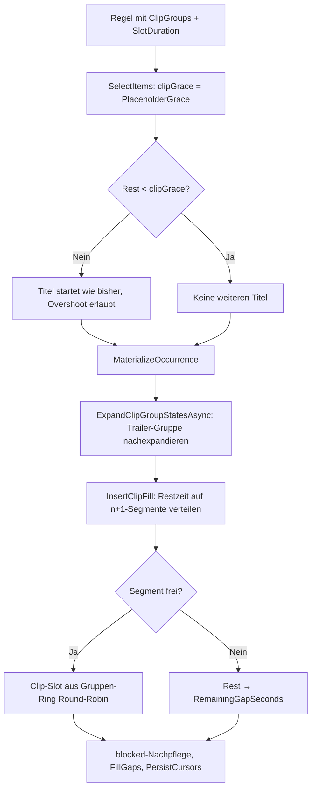

# TV-Sender — Technischer Ablauf: Clip-Gruppen und Restzeit-Auffüllung

## Übersicht

Clip-Gruppen hängen benannte Mengen unklassifizierter Video-`MediaItem`s an `ProgramRule`s.
Steuert eine Regel mindestens eine Gruppe und besitzt eine `SlotDuration`, ersetzt die je-Regel-
Karenzzeit `ProgramRule.PlaceholderGrace` die Titel-Startschwelle am Periodenende: Unterschreitet
die Restzeit die Karenzzeit, startet kein Titel mehr; stattdessen verteilt ein eigener Nachpass
(`ProgramScheduleService.InsertClipFill`) Clip-Slots gleichmäßig auf die `n+1`-Segmente der
Ausstrahlung. Die reservierte System-Gruppe „Trailer" (`ProgramClipGroup.TrailerGroupId = 1`)
wird verzögert aus den frisch materialisierten Film-Ausstrahlungen des Laufs expandiert.

Die bisherige Lückenfüllung `FillGaps` (Platzhalter/Füller-Regeln **zwischen** Ausstrahlungen)
läuft unverändert danach; die Clip-Füllung liegt **innerhalb** der Periode einer Ausstrahlung.

## Ablauf

### 1. Gruppen- und Mitgliederverwaltung

`TVSenderAdminClipGroups.razor` (Tab „Clip-Gruppen" auf `TVSenderAdmin.razor`) ruft
`IProgramClipGroupService` — jede Methode erzwingt serverseitig `RequireAdminAsync`; alle
Mutationen feuern `IProgramScheduleSignal.NotifyScheduleChanged()`.

Beteiligte Komponenten:

- `ProgramClipGroupService.GetGroupsAsync` / `GetGroupCountsAsync` — Gruppenliste (Name ASC)
  samt Mitgliederzahlen; liefert auch die System-Gruppe „Trailer", sofern die Seed-Zeile existiert.
- `CreateGroupAsync` / `RenameGroupAsync` / `DeleteGroupAsync` — `ValidateGroupNameAsync`
  (nicht leer, ≤ `ProgramClipGroup.NameMaxLength` = 255, ordinal-ignore-case eindeutig, ≠
  `TrailerGroupName` für freie Gruppen); `IsSystem`-Gruppen sind für Umbenennen/Löschen gesperrt
  (`InvalidOperationException`). Der NOCASE-Unique-Index auf `Name` sichert die Dubletten- und
  Reservierungsregel zusätzlich auf DB-Ebene ab.
- `GetGroupClipsAsync` — Mitglieder inkl. `Duration`, `DurationProbedAt`, `DurationProbeAttempts`
  und Quellname (Kennzeichnung „keine Laufzeit" in der UI).
- `GetClipCandidatesAsync` — Kandidatenliste: `MediaItem`s **ohne** `MovieMediaItem`-/
  `TVShowEpisodeMediaItem`-Link aller Quellen, LIKE-Suche über `Name` (Wildcard-Escaping),
  optionaler Quell-Filter, `VideoFileExtensions.IsVideoFileName`-Filter, seitenweise
  (Seitengröße 100 in der UI, `take` serverseitig auf ≤ 200 geklemmt).
- `AddClipsToGroupAsync` — `IsSystem`-Gruppe abgewiesen; jedes `MediaItem` muss existieren,
  Video und unklassifiziert sein (sonst `KeyNotFoundException`/`ArgumentException`);
  Composite-PK `ProgramClipGroupItem` verhindert Dubletten, bereits vorhandene Links werden
  übersprungen. `Duration == null` ist zulässig (wird bei der Expansion ausgefiltert).
- `RemoveClipFromGroupAsync` — entfernt einzelne Mitglieder; `IsSystem` abgewiesen.

### 2. Regel mit Clip-Gruppen und Karenzzeit speichern

Der Regel-Dialog in `TVSenderAdmin.razor` zeigt bei `RuleType != Filler` die Checkbox-Liste
`#rule-clip-groups` (alle Gruppen inkl. „Trailer" mit Zusatz „(automatisch befüllt)") und — nur
bei gesetzter `DurationMinutes` — das Feld `#rule-grace-minutes`; sonst den Hinweis
`#rule-clip-groups-hint`. `RuleEditModel.SelectedClipGroupIds`/`GraceMinutes` gehen als
`ProgramRuleInput.ClipGroupIds`/`PlaceholderGrace` in `ProgramRuleService`.

Beteiligte Komponenten:

- `ProgramRuleService.ValidateClipGroupInputAsync` — `ClipGroupIds` nur bei
  `RuleType != Filler` und `SlotDuration != null`; alle Ids müssen existieren
  (`KeyNotFoundException`, die Trailer-Gruppen-Id ist eine reguläre Zeile — fehlt der
  Seed-Datensatz in einer Alt-DB, wird sie wie jede unbekannte Id abgewiesen);
  `PlaceholderGrace` nur mit `SlotDuration`, `> 0` und `< SlotDuration`.
- `CreateRuleAsync` / `UpdateRuleAsync` — setzen `PlaceholderGrace =
  input.PlaceholderGrace ?? ProgramRule.DefaultPlaceholderGrace` (15 min) und ersetzen die
  Links über `ReplaceClipGroupLinksAsync` (Muster `ReplaceGenreLinksAsync`, aber
  materialart-unabhängig).
- `GetRulesAsync` — `Include(r => r.ClipGroups).ThenInclude(c => c.ClipGroup)`;
  `TVSenderAdmin.MaterialLabel` hängt den Suffix „— Clips: {Namen}" an.

### 3. Plangenerierung (`EnsureCoverageAsync`)

1. Regeln werden inkl. `ClipGroups`-Navigation geladen. `BuildClipGroupStates` baut je
   zugeordneter Gruppe (aufsteigend nach `ProgramClipGroupId` = Round-Robin-Reihenfolge) einen
   `ClipGroupState`: Benutzergruppen expandieren sofort über `ExpandClipGroupItemsAsync`
   (Mitglieder, die noch unklassifizierte Videos sind, `Duration != null`,
   `access.Allows(sourceId)` — Filter-Pipeline `FilterClipCandidatesAsync`, geteilt mit
   `ExpandMediaSourceClipsAsync`; `CountNoDuration`/`SkippedNoAccess`-Buchhaltung), die
   Trailer-Gruppe bleibt zunächst leer. `SelectStrandCursor` initialisiert den Ring-Startindex
   je Gruppe über den Cursor-Strang `clipgroup:{groupId}`.
2. `SelectItems` übergibt `clipGrace = rule.PlaceholderGrace`, sofern die Regel Gruppen trägt
   und `SlotDuration` gesetzt ist. `SelectAiringItems`/`SelectAiringItemsInterleaved` brechen
   die Titel-Auswahl zusätzlich ab, sobald `target - accumulated < clipGrace`; die
   Fenster-Bound-Prüfung über `_minStartRemain` bleibt davon unberührt.
3. `MaterializeOccurrence` läuft unverändert (nur Titel). Danach:
   `LoadMovieAiringsAsync`/`BuildMovieAiringsFromSlotsAsync` liefern `airingsByMovie` inkl.
   der frischen Ausstrahlungen; `ExpandClipGroupStatesAsync` expandiert die Trailer-
   `ClipGroupState`s verzögert über `ExpandTrailersAsync` (gleiches Muster wie
   `ExpandTrailerStatesAsync` — die Trailer-Gruppe braucht die Ausstrahlungen dieses Laufs).
4. `InsertClipFill(newSlots, blocked, states, ctx)` gruppiert `newSlots` über `GroupAirings`
   zu Ausstrahlungen und verlegt je Ausstrahlung einer Regel mit Gruppen + `SlotDuration`
   die Slots neu (`FillAiringSegments`): `periodEnd = erstesSlot.Start + SlotDuration`,
   `rest = periodEnd - letztesSlot.End`; bei `rest > 0` wird `rest` gleichmäßig auf die
   `n+1`-Segmente verteilt (Kopfsegment vor dem ersten Titel eingeschlossen, Restbudget wird
   weitergereicht) und jedes Segment sequenziell per `NextClipItem` aus den Gruppen-Ringen
   aufgefüllt (Round-Robin über die Gruppen; die Trailer-Gruppe liefert je Position nur Items
   mit Vorlauf-Treffer per `FindLeadMatchOffset`-Semantik: Filmstart in
   `(position, position + _trailerLead]`). Clip-Slots tragen `ProgramRuleId`/`RuleType` der
   erzeugenden Regel und `MovieId`/`TVShowEpisodeId` = `null` (Trailer-Clips: `MovieId` des
   Films). Freiraum-Wächter: kein Überlapp mit `blocked` (andere Ausstrahlungen) und kein
   Überlapp mit reservierten `Bound`-Fenstern höherpriorer Regeln (`TailLimit` über
   `ctx.BoundStarts`); der letzte Clip darf `periodEnd` überschreiten, solange der Raum frei
   ist — ein überschießender Clip in belegten/gebundenen Raum wird verworfen. Titel-Slots der
   Ausstrahlung werden um die eingefügte Dauer verschoben, `blocked` wird auf die endgültige
   Geometrie nachgepflegt; nicht platzierbarer Rest geht in `SummaryCounters.RemainingGapSeconds`.
5. `FillGaps` läuft unverändert über die verbleibenden Lücken **zwischen** Ausstrahlungen;
   `PersistCursors` schreibt zusätzlich die Clip-Strang-Zeilen (`clipgroup:{groupId}`).

### 4. Neu-Bewertung (`ReconcileAsync`)

1. Regel-Zustände werden inkl. Clip-Gruppen expandiert; die Trailer-Gruppe expandiert hier
   sofort, da `airingsByMovie` aus den persistierten Slots bekannt ist.
2. Die clip-bewusste `AiringReproducible`-Variante klassifiziert Slots zuerst über
   `ClipMediaItemIds(state)` (`MediaItemId` ∈ Clip-Expansion der Regel → Clip-Slot): Die
   titel-gefilterte Teilfolge läuft durch die bestehenden Tail-Checks
   (`FlatAiringTailReproducible`/`InterleavedAiringTailReproducible`); Clip-Slots werden separat
   auf Mitgliedschaft in der aktuellen Clip-Expansion und lückenlose Verkettung geprüft
   (Position/Anzahl wird nicht re-simuliert). Ein entferntes oder nachträglich klassifiziertes
   Mitglied macht die Ausstrahlung invalid → verdrängen und neu planen.
3. `MaterializeOccurrenceEvicting` materialisiert nur Titel; `InsertClipFill` läuft über die
   neu materialisierten Ausstrahlungen in `newSlots`. `RewindCursor` berücksichtigt verdrängte
   Clip-Slots (Clip-Strang zurück auf den Vorgänger).

## Fehlerbehandlung

- **Fehlende Trailer-Seed-Zeile** (Alt-Backup ohne `InsertData`-Seed): `BuildClipGroupStates`
  überspringt Links auf fehlende Gruppen-Zeilen; `GetGroupsAsync` listet „Trailer" schlicht
  nicht; `ValidateClipGroupInputAsync` weist die Id per `KeyNotFoundException` ab.
- **Nachträglich klassifizierte/fehlende Clips:** Die doppelte Prüfung (bei Zuordnung und bei
  Expansion) filtert sie heraus; in der Reproduzierbarkeits-Prüfung invalidieren sie die
  Ausstrahlung und lösen Neuplanung aus.
- **Kein passendes Material / kein freier Raum:** Der verbleibende Rest bleibt eine
  dokumentierte Lücke (`SummaryCounters.RemainingGapSeconds`) und geht an `FillGaps`.
- **Berechtigungen:** `RequireAdminAsync` in jeder Service-Methode; die UI blendet lediglich
  Schaltflächen aus.

## Alt-Backup-Restore

`VideoWebPlayerBackupData` registriert `ProgramClipGroups`, `ProgramClipGroupItems` und
`ProgramRuleClipGroups` in `OptionalRestoreTables` sowie `ProgramRules.PlaceholderGrace` in
`OptionalRestoreColumns`; der neue Block `OptionalRestoreTimeSpanDefaults` injiziert den
Default `"00:15:00"` (`TimeSpan.FromMinutes(15)`) in Zeilen eines Alt-Backups ohne die Spalte.
Ein Regressionstest stellt ein Alt-Backup ohne die neuen Tabellen/Spalte wieder her.
