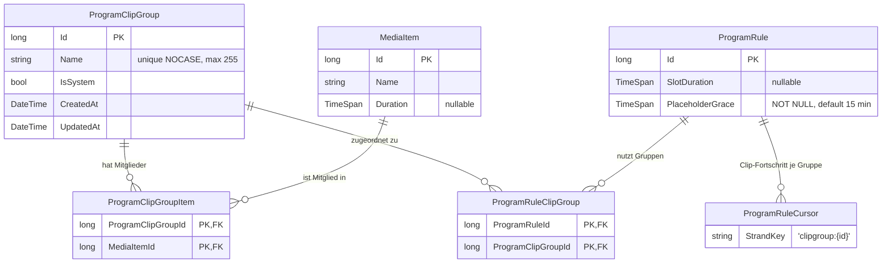

# TV-Sender — Datenmodell

Datenmodell des TV-Senders: die Clip-Gruppen des Sendeplans sowie die
Standby-Einstellung des Live-Streams in `Setup`.

## Entitäten

### `ProgramClipGroup`

Benannte Gruppe von Platzhalter-Clips, die an `ProgramRule`s zugeordnet werden kann.

| Eigenschaft | Typ | Beschreibung |
|-------------|-----|--------------|
| `Id` | `long` (PK) | Primärschlüssel. Konstante `TrailerGroupId = 1` für die System-Gruppe. |
| `Name` | `string` (required, max 255) | Gruppenname; Unique-Index mit `NOCASE`-Kollation (Groß-/Kleinschreibung wird ignoriert). |
| `IsSystem` | `bool` | Reservierte System-Gruppe („Trailer"): nicht umbenenn-, lösch- oder manuell befüllbar. |
| `CreatedAt` / `UpdatedAt` | `DateTime` | Anlege-/Änderungszeitpunkt. |

Seed-Datensatz per Migration `AddProgramClipGroups` (`migrationBuilder.InsertData`):
`{ Id = 1, Name = "Trailer", IsSystem = true }`. `InsertData` läuft nur unter
`db.Database.Migrate()` (Produktiv-DB); Test-/E2E-Fixtures mit `EnsureCreatedAsync` legen die
Zeile über die Seed-Hilfe `SeedTrailerClipGroupAsync`.

### `ProgramClipGroupItem`

Join Clip ↔ Gruppe. Ein Clip darf mehreren Gruppen angehören.

| Eigenschaft | Typ | Beschreibung |
|-------------|-----|--------------|
| `ProgramClipGroupId` | `long` (Composite-PK, FK) | Gruppe; Kaskade beim Löschen der Gruppe. |
| `MediaItemId` | `long` (Composite-PK, FK) | Clip-`MediaItem`; Kaskade beim Löschen des MediaItems. |
| `ProgramClipGroup` / `MediaItem` | Navigationen | — |

### `ProgramRuleClipGroup`

Join Gruppe ↔ Regel — Zusatz-Zuordnung unabhängig von der Materialart der Regel (Muster
`ProgramRuleGenre`).

| Eigenschaft | Typ | Beschreibung |
|-------------|-----|--------------|
| `ProgramRuleId` | `long` (Composite-PK, FK) | Regel; Kaskade beim Löschen der Regel. |
| `ProgramClipGroupId` | `long` (Composite-PK, FK) | Gruppe; Kaskade beim Löschen der Gruppe (das Löschen einer Gruppe entfernt damit auch alle Regel-Zuordnungen). |
| `ProgramRule` / `ClipGroup` | Navigationen | — |

### `ProgramRule` (erweitert)

| Eigenschaft | Typ | Beschreibung |
|-------------|-----|--------------|
| `PlaceholderGrace` | `TimeSpan` (NOT NULL) | Je-Regel-Karenzzeit für die Clip-Füllung; DB-Default `'00:15:00'`, Konstante `DefaultPlaceholderGrace = TimeSpan.FromMinutes(15)`. Wirkt nur mit gesetztem `SlotDuration` und mindestens einer zugeordneten Gruppe. |
| `ClipGroups` | `ICollection<ProgramRuleClipGroup>` | Navigations-Collection der Gruppenzuordnung. |

### `ProgramRuleCursor` (wiederverwendet)

Der Entnahme-Fortschritt je (Regel, Gruppe) wird als eigener Strang persistiert:
`StrandKey = $"clipgroup:{groupId}"`, `LastContentType` = `MediaItem` bzw. `Trailer`. Keine
Schema-Änderung nötig.

## Beziehungen

- `ProgramClipGroup` 1—n `ProgramClipGroupItem` n—1 `MediaItem`: Mitgliedschaften.
- `ProgramClipGroup` 1—n `ProgramRuleClipGroup` n—1 `ProgramRule`: Regel-Zuordnungen.
- Alle Fremdschlüssel kaskadieren; Tests laufen gegen echtes SQLite (Composite-PKs,
  NOCASE-Unique, Löschverhalten).
- Backup-Restore: Alle drei Tabellen stehen in `VideoWebPlayerBackupData.OptionalRestoreTables`,
  `ProgramRules.PlaceholderGrace` in `OptionalRestoreColumns` mit `TimeSpan`-Default über
  `OptionalRestoreTimeSpanDefaults` — Alt-Backups ohne sie bleiben restaurierbar.

## Diagramm

**Migration:** `AddProgramClipGroups` — erzeugt die drei Tabellen (Composite-PKs,
FK-Kaskaden, NOCASE-Unique auf `ProgramClipGroups.Name`), fügt `ProgramRules.PlaceholderGrace`
(`TEXT`, NOT NULL, `DEFAULT '00:15:00'`) hinzu und seedet die Trailer-Gruppe.

## `Setup` (erweitert)

| Eigenschaft | Typ | Beschreibung |
|-------------|-----|--------------|
| `LiveStreamStandbyMediaItemId` | `long?` (nullable) | Standby-Clip des Live-Streams: das `MediaItem`, das die Warm-up-Phase und alle Zustände ohne produzierte Segmente ausliefert; `null` = eingebetteter Standard-Clip. **Weiche Referenz ohne Fremdschlüssel** (Konvention wie `ProgramSlot.MediaItemId`): Ein gelöschtes Medium setzt die Einstellung nicht zurück — die Standby-Vorbereitung fällt dann auf den Standard-Clip zurück. |

**Migration:** `AddSetupLiveStreamStandbyMediaItem` — fügt die nullable Spalte
`LiveStreamStandbyMediaItemId` zu `Setups` hinzu.
`Setups.LiveStreamStandbyMediaItemId` steht in
`VideoWebPlayerBackupData.OptionalRestoreColumns`; Alt-Backups ohne die Spalte bleiben
restaurierbar (Regressionstest vorhanden).
